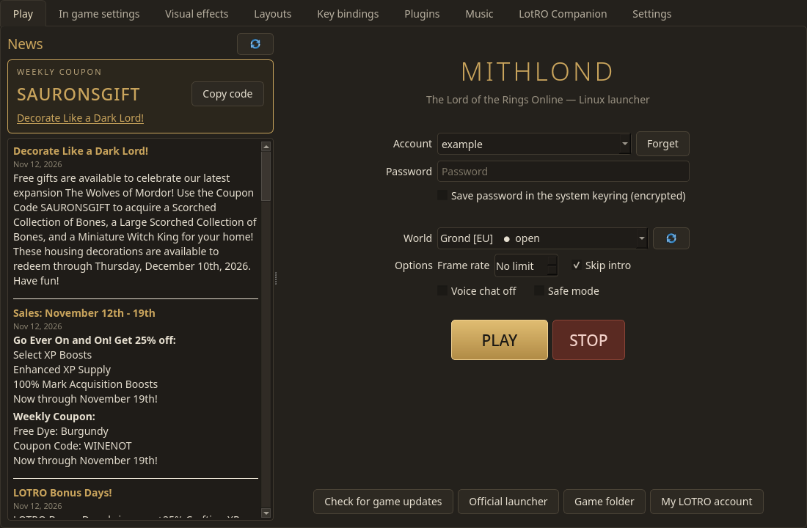
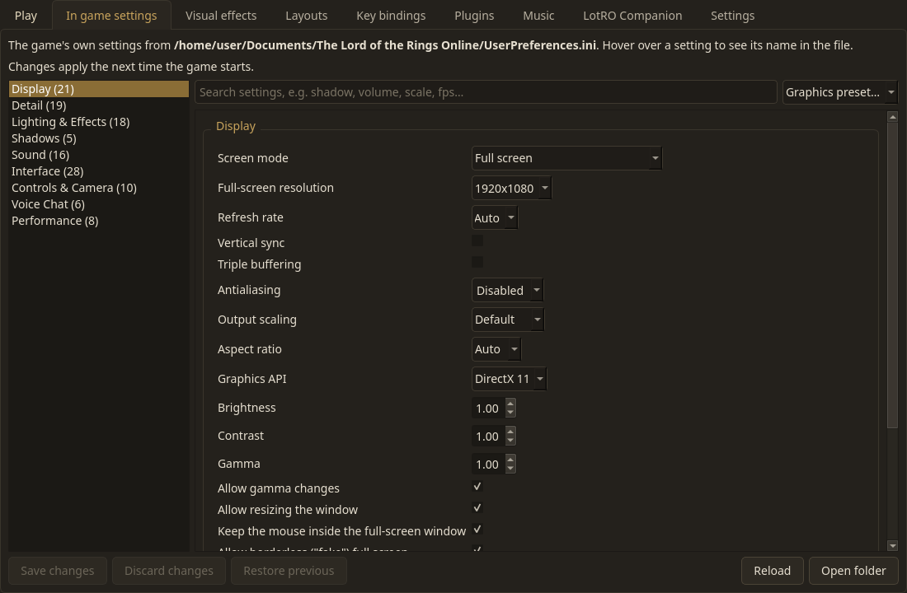
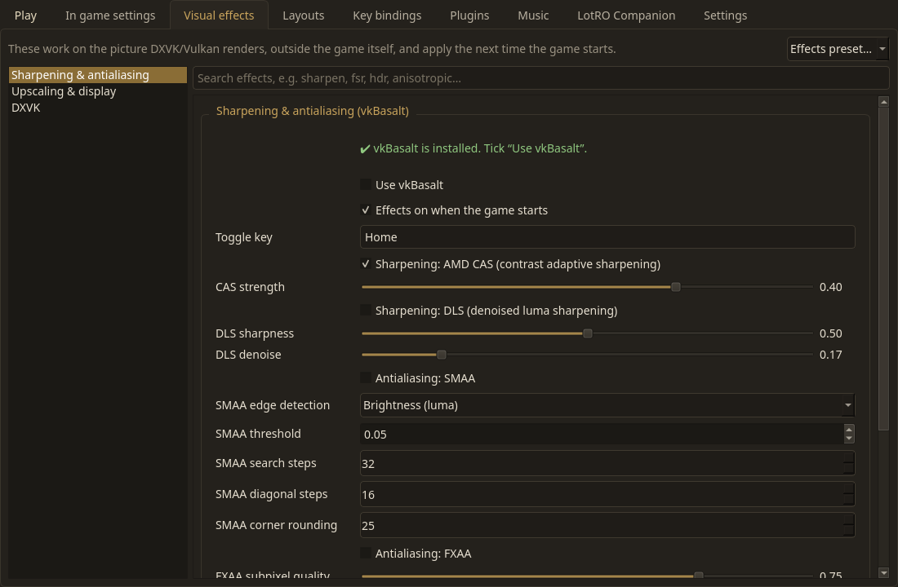
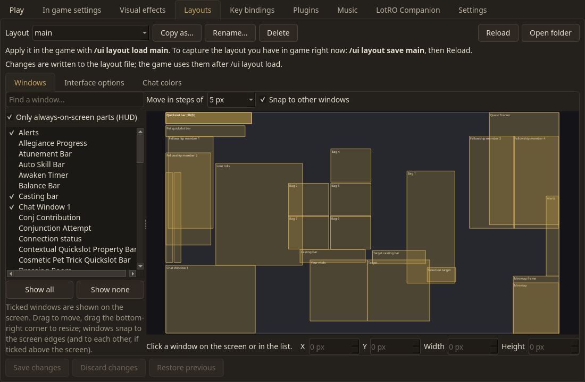
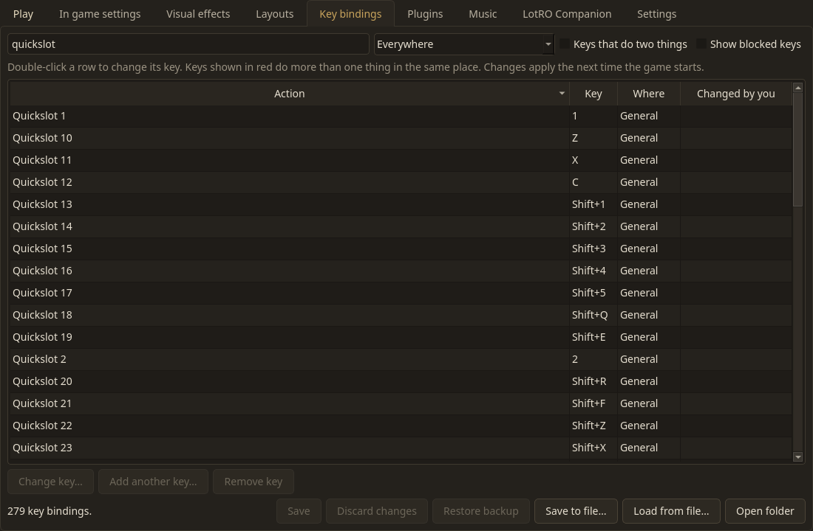
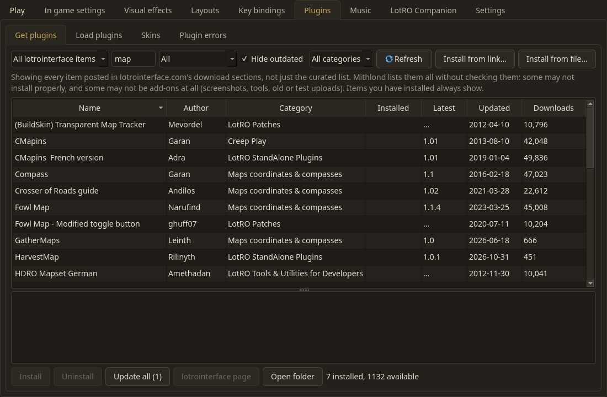
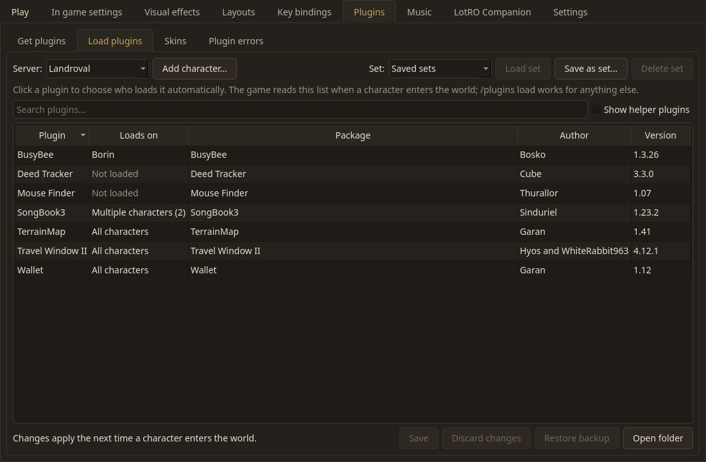
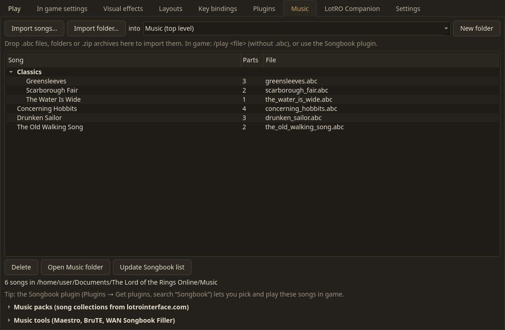

# Mithlond

> **Disclaimer:** this project is entirely vibe coded. I have no idea what I'm doing, I just wanted an
> all-in-one Linux launcher for LOTRO. Use it at your own risk.

A native Linux launcher for **The Lord of the Rings Online**, built with Python and Qt.

It logs you in and starts the game through Wine or Proton. It also installs plugins, skins and music from
lotrointerface.com, manages your ABC song library and the Songbook plugin's song list, and runs LotRO Companion
alongside the game.

## Features

| Tab | What it does |
|---|---|
| **Play** | Logs in with the official login servers and shows each world's status. Waits in the login queue, then starts the game client through Wine or Proton (umu-run). The **STOP** button closes every game client and every helper program. The news panel shows the official lotro.com news, with this week's **coupon code** at the top. |
| **In game settings** | The game's own options (graphics, display, sound, interface, controls, voice chat, performance) in categories, edited while the game is closed. Saves only what you change, with a backup. |
| **Visual effects** | vkBasalt sharpening/antialiasing/ReShade shaders, gamescope upscaling (FSR, NIS) and display options, DXVK options (forced anisotropic filtering, frame latency, VSync). |
| **Layouts** | Edit saved interface layouts (`/ui layout save`/`load`): drag and resize windows on a screen-sized canvas, interface options, chat colors and sizes. |
| **Key bindings** | Every key binding in the game, searchable, with keys that do two things marked. Change, add or remove keys while the game is closed, and save or load whole key binding files. |
| **Plugins** | **Get plugins**: plugins and skins from [lotrointerface.com](https://www.lotrointerface.com/); browse, search, install (dependencies included), update and uninstall, alongside LOTRO Plugin Compendium and plugins installed by hand. **Load plugins**: which characters auto-load which plugin, per server, with named sets. **Plugin errors**: the Lua errors the game logged. |
| **Music** | Import `.abc` songs (files, folders, zips, drag and drop) and browse them by title and part count. Music packs from lotrointerface.com. Keeps the **Songbook** plugin's song list up to date. Downloads and starts **Maestro** and **WAN Songbook Filler**, and links to **BruTE**. |
| **LotRO Companion** | Downloads, updates and starts **LotRO Companion**, and can open and close it along with the game. |
| **Settings** | Game, documents, plugins and downloads folders. Runner (system Wine or any Proton) and prefix, environment variables, and game options (gamescope, MangoHud, GameMode, DXVK HUD…). |

Your password is saved in the desktop keyring (KWallet, GNOME Keyring, KeePassXC… through the Secret Service API).
It never goes into a file.

## Screenshots

(Made with a sample setup: the account, characters, plugins and songs are examples.)

| | |
|---|---|
|  |  |
| **Play:** login, world status, news and the weekly coupon | **In game settings:** the game's options by category, with search and presets |
|  |  |
| **Visual effects:** vkBasalt, gamescope and DXVK | **Layouts:** move and resize interface windows, with steps and snapping |
|  |  |
| **Key bindings:** search, change, find keys that do two things | **Get plugins:** the curated list or every lotrointerface item (with the note shown here) |
|  |  |
| **Load plugins:** which characters auto-load each plugin, per server | **Music:** songs, the Songbook list, music packs and tools |

## Getting started

1. Download `Mithlond-<version>-x86_64.AppImage` and **make it executable**. Browsers always save downloads
   without that permission. If you skip this, double-clicking opens it in an archive program ("archive type not
   supported") instead of running it. Either:
   - in a terminal: `chmod +x ~/Downloads/Mithlond-*.AppImage`, or
   - in your file manager: right-click the file → **Properties** → **Permissions** → tick
     **"Allow executing file as program"** (or "Executable").

   Then double-click it. Everything it needs is bundled, including umu-run for Proton: nothing else has to be
   installed. The first game start with Proton downloads the Steam Runtime and Proton, which takes a few minutes.
2. **Settings → LOTRO game folder:** pick the folder with `lotroclient.exe` (Detect tries the usual places).
3. **Settings → Runners and Prefix:** Proton is the default. Mithlond picks a Proton build you already have, or
   umu's own (UMU-Proton). If you play LOTRO through Faugus (including the Flatpak), it starts with Faugus's
   prefix and Proton. You can also choose system Wine, if it's installed, and any other prefix.
4. **Settings → Game documents folder:** this is where the game keeps plugins, music and settings. Use
   **Choose…** to pick one of the folders found on your computer (or make a new one). Mithlond starts the game
   with that folder, whatever Wine prefix it runs in.
5. **Play:** enter your account, pick a world, press **PLAY**.

More in the **[User guide](docs/user-guide.md)**. If something doesn't work, see
**[Troubleshooting](docs/troubleshooting.md)**. To ask for help, click **Export logs…** in the Log panel
and send the zip it saves (personal details are removed).

### Optional programs

| Program | Used for |
|---|---|
| `secret-tool` (libsecret) and a keyring | Saving your password |
| `wine` | The "Wine (system)" runner. Not needed for Proton, the default |
| `bsdtar` (libarchive) or `7z` | Addons packed as `.rar`/`.7z` |
| `java` (17+) | Running Maestro natively, and LotRO Companion's "native" mode |
| `gamescope`, `mangohud`, `gamemoderun` | The matching game options |

## Building from source

```sh
python3 -m mithlond                 # run from the source tree (needs PySide6 + requests)
packaging/build-appimage.sh         # build dist/Mithlond-<version>-x86_64.AppImage
./install.sh                        # or install the source version for your user
```

See **[Development](docs/development.md)** for the code layout, tests and how the AppImage is made.

## Credits and license

GPL-3.0-or-later. The login protocol follows [OneLauncher](https://github.com/JuneStepp/OneLauncher) (GPL-3.0).
Addon handling is compatible with LOTRO Plugin Compendium, and the Songbook data format matches Chiran's
Songbook. Thanks also to [lembas](https://github.com/mawilms/lembas),
[LotRO Companion](https://github.com/LotroCompanion/lotro-companion),
[Maestro](https://github.com/NikolaiVChr/maestro), [BruTE](https://github.com/bruzo/BruTE-) and
[WAN Songbook Filler](https://lotro.hanft.de/wansongbookfiller/).

**Bundled in the AppImage:** [umu-launcher](https://github.com/Open-Wine-Components/umu-launcher)'s `umu-run`
(GPL-3.0; the unmodified release zipapp, source at that link), Python and Qt for Python (PySide6, LGPL-3.0), and
X11/Wayland support libraries from [Debian 11](https://www.debian.org/) (sources at
[sources.debian.org](https://sources.debian.org/)). The Visual effects tab drives
[vkBasalt](https://github.com/DadSchoorse/vkBasalt), [gamescope](https://github.com/ValveSoftware/gamescope) and
[DXVK](https://github.com/doitsujin/dxvk) when they are installed; they are not bundled.

Not affiliated with Standing Stone Games or Daybreak. The Lord of the Rings Online is a trademark of its owners.
